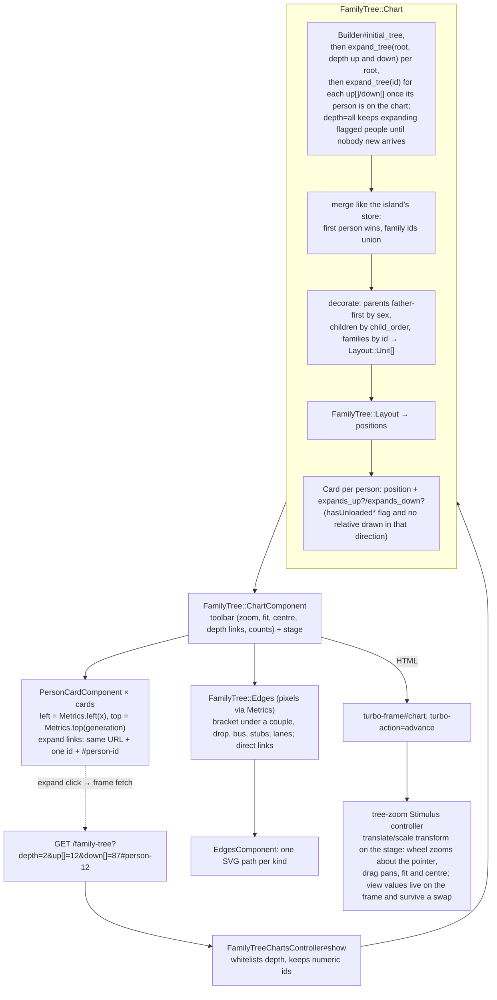
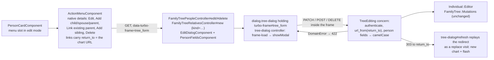

# Family Tree — Architecture

Mermaid diagrams of the family-tree subsystem as it is today. The migration
plan (`family-tree-hotwire-plan.md`) says where it is going; when a chunk
lands, its diagram moves from "Planned" to "Current" here, in the same PR.

## Current

### Layout engine (`FamilyTree::Layout`, chunk 1)

Pure Ruby. Ordered units in, slot positions out. Nothing here knows about
pixels or the database.

```mermaid
flowchart TD
    IN["individual_ids + Unit[] (id, parent_ids, child_ids)<br/>order is meaning: first parent left, children in birth order"]
    IN --> F

    subgraph F["Forest"]
        direction TB
        P["prune: drop ids outside the loaded set,<br/>duplicate children"]
        B["blocks: walk co-parent edges, seat spouses<br/>S1 P S2 / H1 W H2"]
        PU["parent unit per child: deepest listing unit"]
        A["anchor per block: first member with loaded parents<br/>→ tree edge to its parent unit (phantom for parentless units)"]
        CY["cut cycles"]
        T["trees + groups (children by unit seat)<br/>links = every other parent→child relation"]
        P --> B --> PU --> A --> CY --> T
    end

    F -->|"one tree at a time"| TT["TidyTree<br/>Buchheim/Walker port from d3-hierarchy<br/>separation = half-widths + (siblings ? 0 : 1)<br/>centre over children's cards, per marriage group"]
    TT -->|"local x per block, depth"| PK

    subgraph PK["Packing"]
        direction TB
        O["order: tree holding the first id,<br/>then BFS over links, then largest unlinked"]
        G["row offset from the discovering link<br/>(child = unit row + 1)"]
        X["column offset: child under unit midpoint,<br/>cleared to the side the linked spouse sits on"]
        O --> G --> X
    end

    PK --> N["normalise: leftmost card x = 0, top real row = 0"]
    N --> OUT["positions {id => (x, generation)}, width, height, sketch"]
```

### The chart (`/family-tree`)

The Builder and the queries are used as they are; `Chart` composes their
responses the way the old island's store did and decorates the order.

### Edit mode (chunk 3, `?edit=1` for a signed-in user)

A visitor with `?edit=1` gets the plain chart; the controller only grants
`:edit` when signed in, and every form requires a user.

## Planned

Nothing at the moment. The island, its JSON API under `/api/family-tree`
and the dagre/d3 dependencies were removed at cutover (chunk 4). Ideas the
design draws but no backend serves yet (hidden-relative counts on the expand
tabs, the selected-person panel, person search, linked-artifact badges) start
as new plan documents.